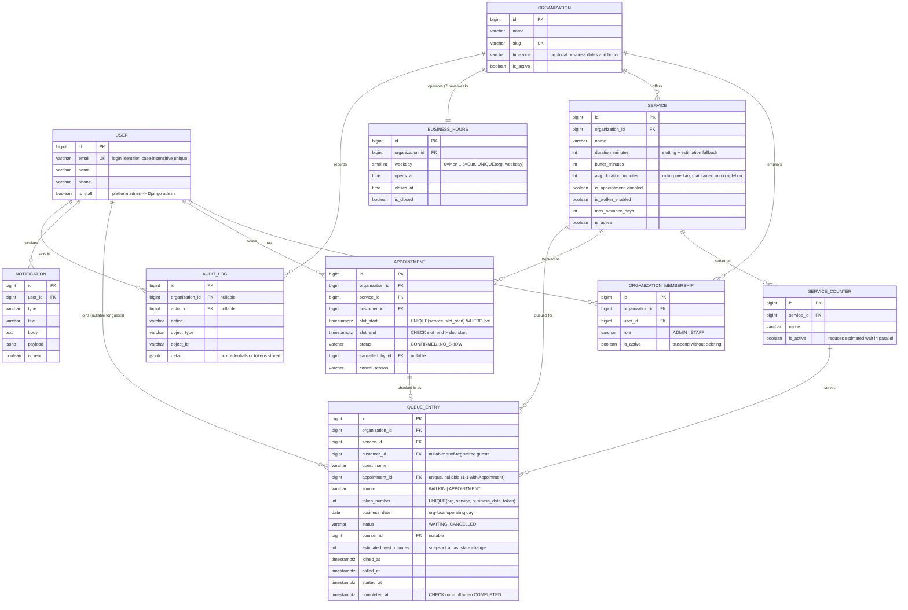

# Database ER Diagram

## Integrity guarantees

| Concern | Mechanism |
|---|---|
| Double-booked slot | Partial unique index `uniq_live_booking_per_service_slot` on `(service, slot_start)` excluding CANCELLED/NO_SHOW — enforced by PostgreSQL even under concurrent requests |
| Duplicate tokens | Unique `uniq_token_per_org_service_day` on `(organization, service, business_date, token_number)`; token allocation additionally serialized by `SELECT ... FOR UPDATE` on the Service row inside the joining transaction |
| Invalid queue transitions | Enforced in `queues.services.ALLOWED_TRANSITIONS` (service layer) + `completed_requires_completed_at` DB check |
| Tenant isolation | All org-scoped queries filter through the requester's active `OrganizationMembership`; customer queries filter by ownership |
| Duplicate memberships | Unique `(organization, user)` |
